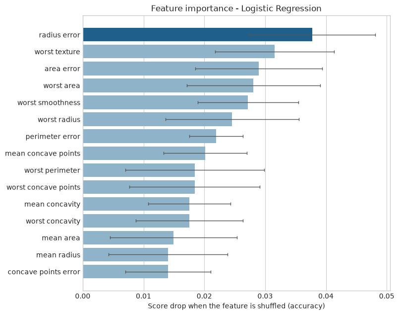
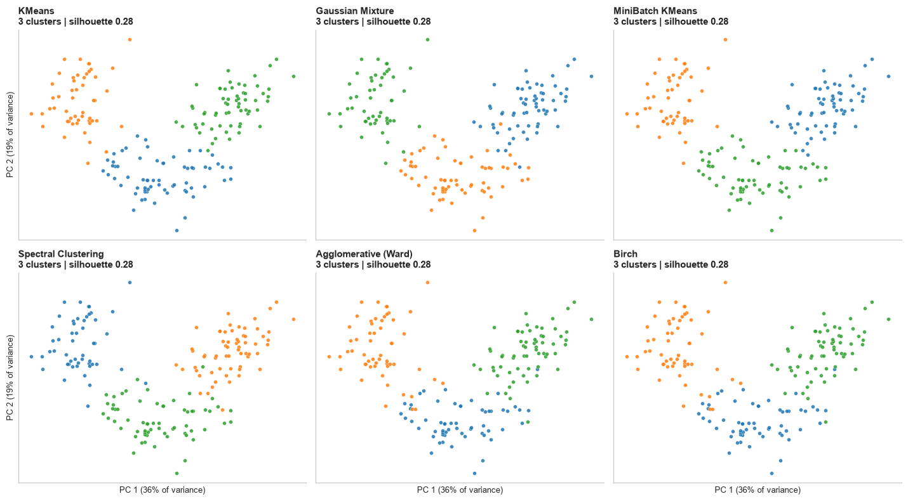

<div align="center">


# multimodel-analysis documentation

**Compare many scikit-learn models in a few lines of code: classification, regression, clustering, anomaly detection and dimensionality reduction.**

[](https://udityamerit.github.io/Multimodel-Analysis-Pacakge-Documentation/)
[](https://pypi.org/project/multimodel-analysis/)
[](https://pypi.org/project/multimodel-analysis/)
[](https://pepy.tech/projects/multimodel-analysis)
[](https://github.com/udityamerit/Multimodel-Analysis-Pacakge/blob/main/LICENSE)

[**Read the documentation**](https://udityamerit.github.io/Multimodel-Analysis-Pacakge-Documentation/) ·
[Package on GitHub](https://github.com/udityamerit/Multimodel-Analysis-Pacakge) ·
[PyPI](https://pypi.org/project/multimodel-analysis/) ·
[Report an issue](https://github.com/udityamerit/Multimodel-Analysis-Pacakge/issues)

</div>

---

This repository holds the source of the documentation website for [`multimodel-analysis`](https://pypi.org/project/multimodel-analysis/). The site documents version **0.6.1** (Python 3.10+, Apache-2.0).

**Live site: https://udityamerit.github.io/Multimodel-Analysis-Pacakge-Documentation/**

## Contents

- [What is on the site](#what-is-on-the-site)
- [The package in 30 seconds](#the-package-in-30-seconds)
- [Package links](#package-links)
- [Where the numbers come from](#where-the-numbers-come-from)
- [Repository layout](#repository-layout)
- [Run locally](#run-locally)
- [Deployment](#deployment)
- [Updating for a new package release](#updating-for-a-new-package-release)
- [Contributing](#contributing)
- [Author](#author) · [License](#license)

## What is on the site

| Section | What you get |
| :--- | :--- |
| **Getting started** | Introduction, installation for Windows, macOS, Linux and Conda, a quickstart for every analyser, and help choosing the right class |
| **Guides** | How it works, choosing models, classification and regression, tuning and cross-validation, clustering, anomaly detection, dimensionality reduction, explainability, reports and saving models, reading the results |
| **Evidence** | Measured results for all five analysers (interactive explorer, 13 charts) and a confusion-matrix metrics calculator |
| **Reference** | Model reference (69 models with keys and tuned parameters) and a searchable 112-entry API reference |
| **More** | Limitations, troubleshooting, full changelog (0.1.4 to 0.6.1), links and resources, licence |

Press <kbd>Ctrl</kbd> + <kbd>K</kbd> on the site to search every section and API entry. Light and dark themes follow your system setting.

## The package in 30 seconds

| Class | Task | Models (default / total) |
| :--- | :--- | :---: |
| `MultiModelClassifier` | Predict a category | 8 / 17 |
| `MultiModelRegressor` | Predict a number | 9 / 19 |
| `MultiModelClusterer` | Find groups, no labels needed | 7 / 14 |
| `MultiModelAnomalyDetector` | Find unusual rows, no labels needed | 6 / 7 |
| `MultiModelReducer` | Compress many columns into a few | 7 / 12 |

All five share one workflow: build the object, `run_all_models()`, `show_tabular_report()`, then plot, save or explain. The supervised classes also offer `cross_validate_models()`, `tune_models()`, `preprocess=True`, feature importance and partial dependence. Reports save as CSV, Excel, HTML or JSON, or as one self-contained file with `save_html_report()`, and trained models are saved and reloaded with `save_model()` and `load_model()`.

```bash
pip install multimodel-analysis
pip install "multimodel-analysis[excel,boost,umap]"   # optional extras
```

```python
from sklearn.datasets import load_breast_cancer
from multimodel_analysis import MultiModelClassifier

X, y = load_breast_cancer(return_X_y=True, as_frame=True)
clf = MultiModelClassifier(X, y, test_size=0.2, random_state=42)
results = clf.run_all_models()
clf.show_tabular_report(results)
```

<div align="center">


</div>

## Package links

| Resource | Link |
| :--- | :--- |
| PyPI | https://pypi.org/project/multimodel-analysis/ |
| Source code | https://github.com/udityamerit/Multimodel-Analysis-Pacakge |
| Issues | https://github.com/udityamerit/Multimodel-Analysis-Pacakge/issues |
| Changelog | https://github.com/udityamerit/Multimodel-Analysis-Pacakge/blob/main/CHANGELOG.md |
| Guides (`docs/`) | https://github.com/udityamerit/Multimodel-Analysis-Pacakge/tree/main/docs |
| Example notebooks | https://github.com/udityamerit/Multimodel-Analysis-Pacakge/tree/main/examples |
| Download statistics | https://pepy.tech/projects/multimodel-analysis |

## Where the numbers come from

The results explorer reads `assets/data/results.json`, and the charts in `assets/img/` are the package's own output. Both were produced by running version 0.6.1 on scikit-learn's bundled datasets with `test_size=0.2`, `scaled_data=True` and `random_state=42` (clustering used `n_clusters=3`, reduction 2 components). Timings depend on the machine, so treat them as indicative.

## Repository layout

| Path | Purpose |
| :--- | :--- |
| `index.html` | All documentation content (single page) |
| `index.css` | Styles, light and dark themes |
| `app.js` | Navigation, search palette, tabs, results explorer, calculator, API dialogs |
| `assets/js/api-data.js` | API reference data (single source for the list, dialogs and search) |
| `assets/data/results.json` | Measured results for all five analysers |
| `assets/img/` | Logo and generated charts |
| `.github/workflows/deploy.yml` | Publishes the site to GitHub Pages |

There is no build step and no runtime dependency: it is plain HTML, CSS and JavaScript.

## Run locally

Fetching `results.json` needs http, so serve the folder rather than opening the file directly:

```bash
python -m http.server 8000
```

Then open http://localhost:8000.

## Deployment

`.github/workflows/deploy.yml` publishes the site to GitHub Pages on every push to `main`. It copies only the files the site needs (`index.html`, `index.css`, `app.js`, `assets/`, `.nojekyll`) into the published artifact. In the repository settings, set **Pages → Source** to **GitHub Actions**.

## Updating for a new package release

1. Install the new version of `multimodel-analysis` and re-run the benchmark to regenerate `assets/data/results.json` and the charts in `assets/img/`.
2. Compare the package's `docs/api.md` and `docs/models.md` with `assets/js/api-data.js` and the **Model reference** section of `index.html`.
3. Add the release notes to the **Changelog** section and bump the version in `index.html` (version pill, install check, footer) and in this README.

## Contributing

Issues and pull requests are welcome. If you change an API signature in the package, update `assets/js/api-data.js` (and `docs/api.md` in the package) together.

## Author

**Uditya Narayan Tiwari**: [Portfolio](https://udityanarayantiwari.netlify.app/) · [LinkedIn](https://www.linkedin.com/in/uditya-narayan-tiwari-562332289/) · [GitHub](https://github.com/udityamerit) · [PyPI](https://pypi.org/project/multimodel-analysis/)

## License

The package is released under the Apache License 2.0. The documentation site source in this repository is released under the MIT License (see [`LICENSE`](LICENSE)).
